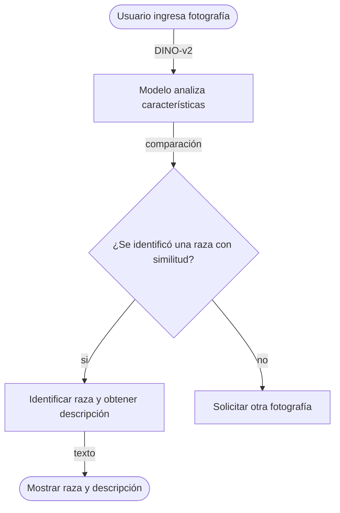
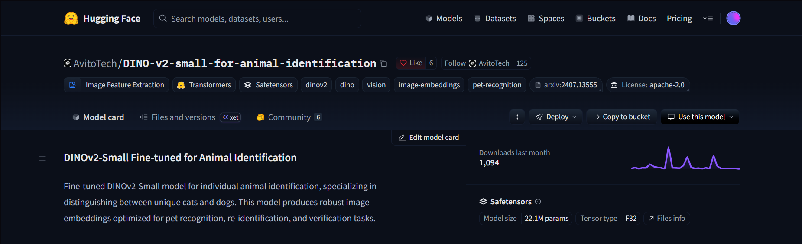

# [You never walk alone]

> [Una frase que resuma qué hace el proyecto]

**Proyecto integrador · Herramientas de IA**

**Grupo:** A1  · **Equipo:** A4

## 👥 Integrantes

|Nombre completo|
|---|
|Pablo Israel Avalos Moreno|
[Hector Ulises Serrano Ramos|
|Jessica Abigail|
|Maria Isabella Rangel Gutierréz|

## 1. Caso de uso

**Necesidad:** Identificar la raza de un perro mediante una fotografía digital de su cara o cuerpo completo, devolviendo la raza correspondiente y su descripción.

**Entrada:** El usuario proporciona una fotografía en formato digital de la cara o cuerpo completo del animal que se quiere conocer la raza.
**Salida:** El sistema genera un vector de características y devuelve la raza de acuerdo a las similitudes encontradas.

## 🔀 Cómo funciona

## 2. Modelo abierto elegido

|Dato|Respuesta|
|---|---|
|Identificador|[AvitoTech/DINO-v2-small-for-animal-identification](https://www.google.com/url?q=https%3A%2F%2Fhuggingface.co%2FAvitoTech%2FSigLIP2-Base-for-animal-identification)|
|Tarea (pipeline tag)|`[mage-feature-extraction (Extracción de Embeddings para Re identificación)]`|
|Número de parámetros|[ 22,000,000]|
|Licencia|[Apache 2.0 ]|
|Limitación o sesgo declarado|[ Disminución en la precisión de identificación cuando las fotografías presentan iluminación deficiente, ángulos muy inclinados o cuando el rostro/cuerpo de la mascota se encuentra parcialmente ocluido.]|

## 3. Viabilidad de hardware

Memoria mínima=N×2 bytes≈ ? GB

- **VRAM disponible en Colab:** [14 ] GB ([GPU-T4])
- **Dónde se ejecuta:** [Colab on GPU]
- **Por qué:** [Se ejecutará en Google Colab con GPU. El modelo requiere únicamente ~88.4 MB, lo que representa menos del 5% de la VRAM asignada por Colab. Esto garantiza una inferencia rápida y local sin exceder los recursos del entorno gratuito ni depender de cuotas de una API externa. ]

## 4. Riesgo ético

- **Riesgo:** [Posible error en la comparación de imágenes, y a futuro, pueden existir riesgos mayores debido al uso de datos personales. ]
- **Mitigación:** [Para nuestro riesgo actual (comparación falsa) podemos definir de manera más precisa los parámetros de las comparaciones. ]

## 5. Evidencia

